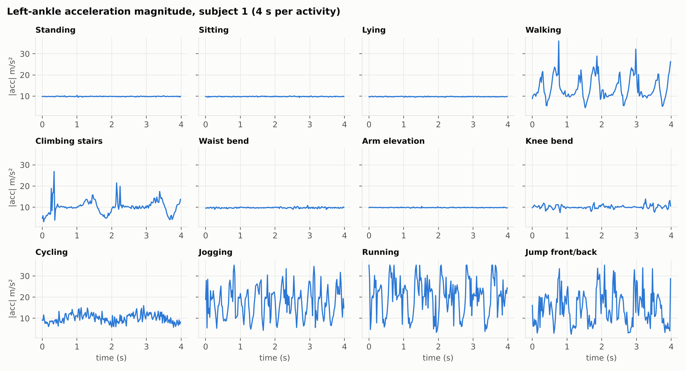
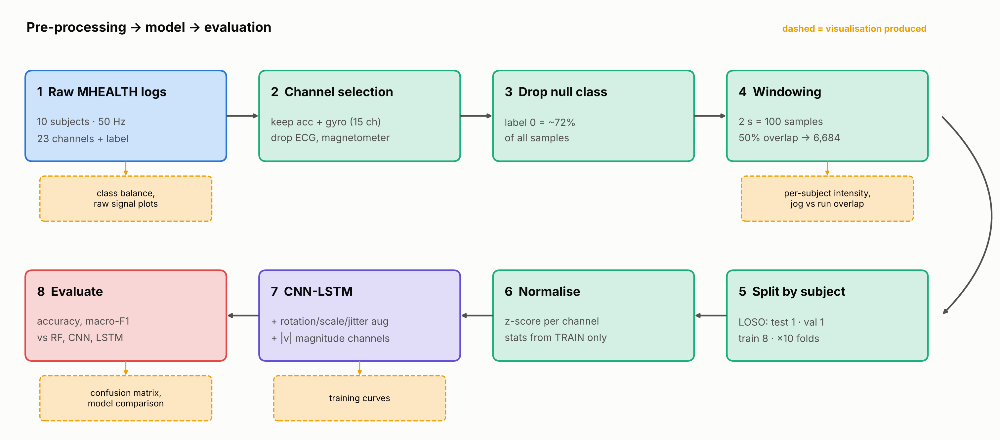
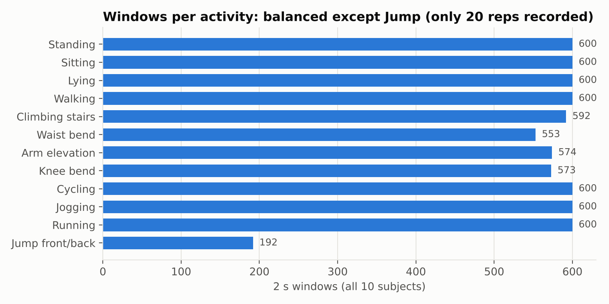
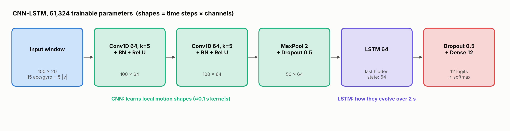
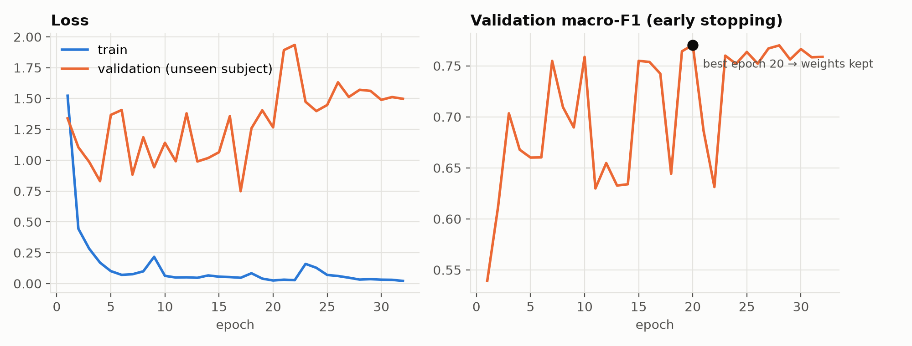
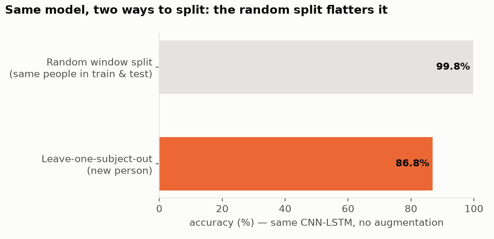
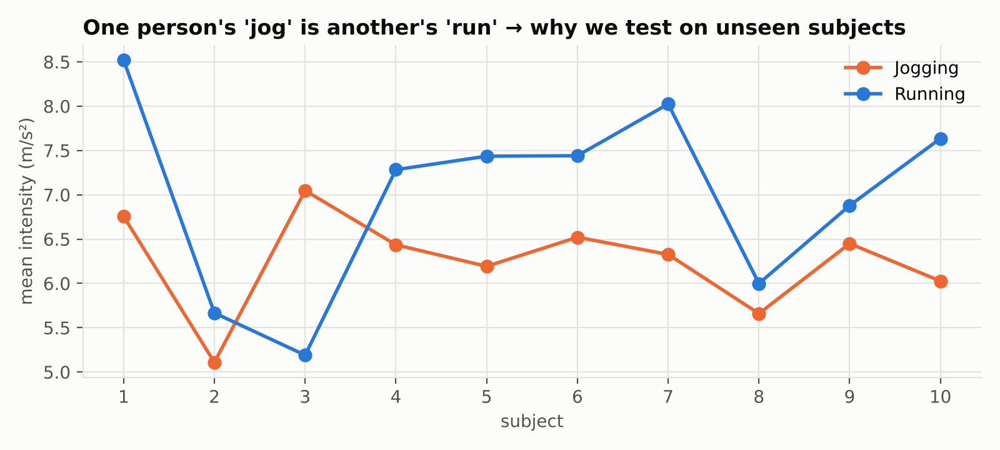
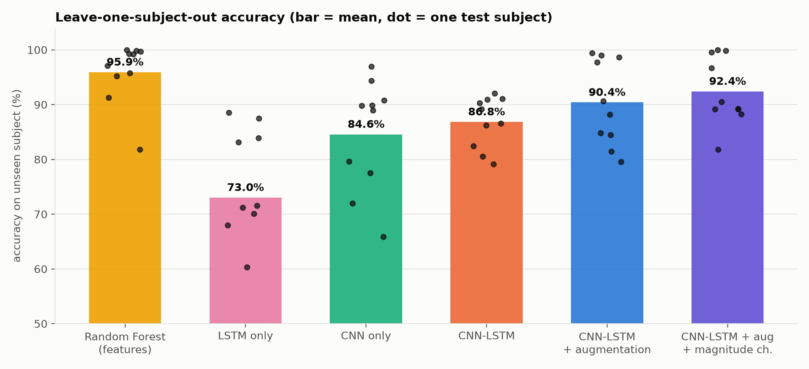
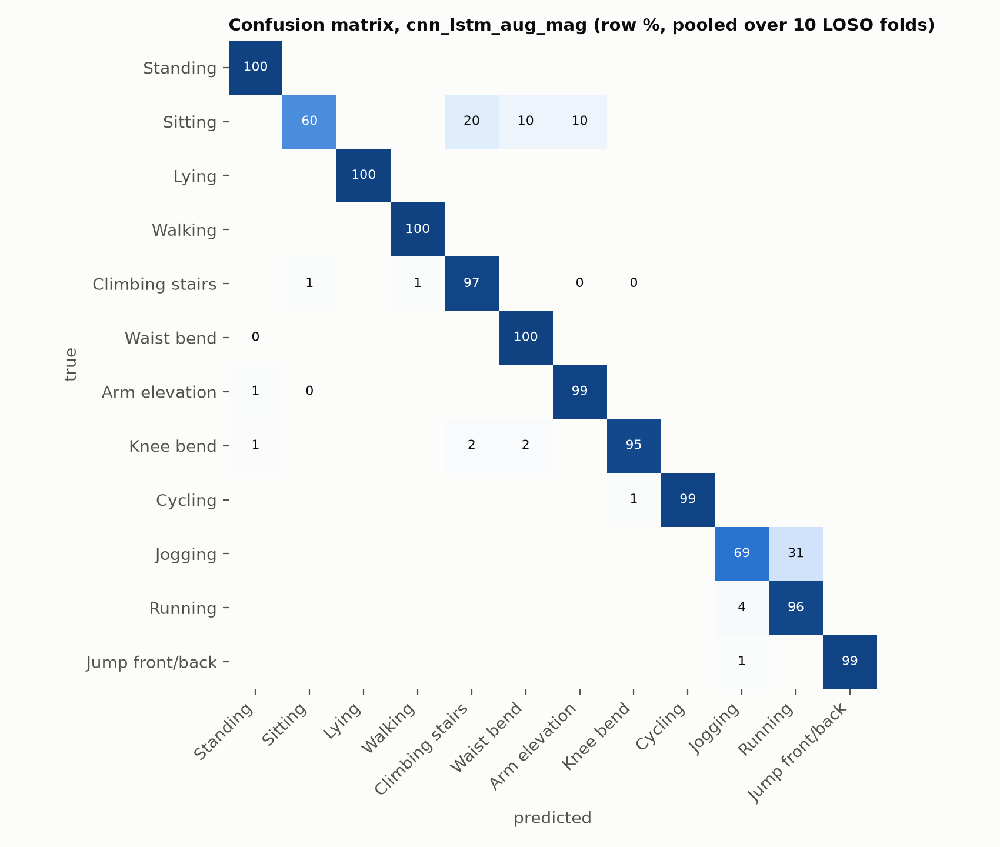
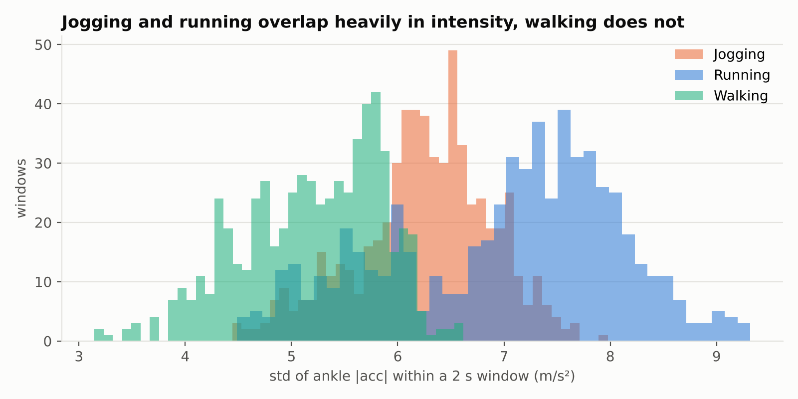

# Bosch_LSTM_CNN — Human Activity Recognition from Wearable Sensors

A CNN-LSTM that recognises 12 human activities from wrist, ankle and chest accelerometer + gyroscope signals, evaluated the honest way: **on people the model has never seen**.

Built as problem statement #8 (Bosch) of the EST (UCS321) mini project at TIET, as a learning exercise in deep learning for time series.

| | Accuracy on an unseen person | Macro-F1 |
|---|---|---|
| **Final CNN-LSTM** (augmentation + magnitude channels) | **92.4% ± 5.9** | **91.2% ± 6.9** |
| Random Forest on 115 hand-crafted features (baseline) | 95.9% ± 5.4 | 95.9% ± 5.1 |
| Same CNN-LSTM, *random* window split (leaky, for comparison) | 99.8% | 99.8% |

Mean ± standard deviation over 10 leave-one-subject-out folds. The 99.8% number is wrong in a useful way; [section 6](#6-the-998-trap-why-the-split-matters) explains why.

---

## Contents
1. [The problem](#1-the-problem)
2. [The data](#2-the-data)
3. [Pre-processing](#3-pre-processing)
4. [The model](#4-the-model)
5. [Training](#5-training)
6. [The 99.8% trap: why the split matters](#6-the-998-trap-why-the-split-matters)
7. [Results](#7-results)
8. [Where it goes wrong](#8-where-it-goes-wrong)
9. [Limitations and what I'd do next](#9-limitations-and-what-id-do-next)
10. [Run it yourself](#10-run-it-yourself)
11. [Repository layout](#11-repository-layout)
12. [References](#12-references)

---

## 1. The problem

Bosch wants gesture/activity-aware human-machine interfaces on the factory floor. The task: given a short stream of accelerometer and gyroscope readings from body-worn sensors, say what the person is doing. The brief asks specifically for a **CNN-LSTM**, a flow diagram of the pre-processing, and visualisations of the data and results.

The hard part is not getting a high number. It's getting a number that still holds when a **new worker** puts the sensors on, which is the only situation that matters in deployment.

## 2. The data

[UCI MHEALTH](https://archive.ics.uci.edu/dataset/319/mhealth+dataset) (Banos et al., 2014; CC BY 4.0).

- **10 volunteers**, three Shimmer2 sensors strapped to the **chest**, **right wrist** and **left ankle**.
- Sampled at **50 Hz**. Accelerometer in m/s², gyroscope in deg/s.
- **12 activities:** standing, sitting, lying, walking, climbing stairs, waist bend, arm elevation, knee bend, cycling, jogging, running, jump front/back.
- Each `.log` file has 23 columns + 1 label. Label 0 means "not part of the protocol" (transitions between activities).



What this plot tells you before any modelling:
- **Static postures** (standing, sitting, lying) are flat lines at ≈ 9.8 m/s², which is just gravity. Their *magnitude* is identical; only the *direction* of gravity relative to the sensor separates them.
- **Jogging, running and jumping** all look like high-variance noise. They differ in rhythm and peak shape, which is a temporal pattern. That is the argument for a model that reads sequences.

## 3. Pre-processing



Every step below is a decision, so each comes with the reason.

| Step | What | Why |
|---|---|---|
| Channel selection | Keep 15 channels: chest acc (3), ankle acc + gyro (6), wrist acc + gyro (6). Drop ECG and magnetometer. | The brief is accelerometer + gyroscope. ECG measures the heart, not motion. Magnetometer readings depend on the local magnetic field (where you stand in the building), not on the activity. The chest unit has no gyroscope. |
| Drop null class | Remove label 0 (≈ 72% of all samples). | These are transitions with no defined class; training on them as a 13th class would teach the model a garbage category. |
| Windowing | 2 s windows (100 samples), 50% overlap (stride 50). Windows are cut **only inside a contiguous run of one label**. | 2 s covers at least one full stride/cycle of every activity. Cutting inside one-label runs means every window has exactly one true label, with no mixed windows at boundaries. Result: **6,684 windows** of shape 100 × 15. |
| Split by subject | Leave-one-subject-out (LOSO): test on 1 person, early-stop on 1, train on 8. Repeat for all 10. | The deployment question is "does it work on someone new?". See [section 6](#6-the-998-trap-why-the-split-matters). |
| Normalisation | Z-score each channel using mean/std of the **training fold only**. | Using the test subject's statistics would leak information about them into the model. |

Class balance after windowing: ~550–600 windows per activity, except jump front/back with 192 (it was only performed 20 times). Handled with class weights, see [section 5](#5-training).



## 4. The model



```
input (B, 100, 20)
 → Conv1D(64, k=5) → BatchNorm → ReLU
 → Conv1D(64, k=5) → BatchNorm → ReLU
 → MaxPool(2) → Dropout(0.5)          # 100 → 50 time steps
 → LSTM(64), keep last hidden state
 → Dropout(0.5) → Linear(12)           # logits
```
61,324 trainable parameters.

**Why a CNN and an LSTM, in that order?**
- A **1-D convolution** slides a small kernel (5 samples = 0.1 s) along time, across all channels at once. It learns short local shapes such as a heel strike or an arm swing, and the same kernel is reused at every time step, so it is cheap and does not care *where* in the window the shape occurs.
- **Max pooling** halves the sequence (100 → 50), so the LSTM has fewer steps to process and gets a slightly coarser, more robust signal.
- An **LSTM** reads those 50 feature vectors in order and carries a memory cell, so it can relate one stride to the next (rhythm, cadence). Only its final hidden state, a summary of the whole 2 s, goes to the classifier.
- **BatchNorm, dropout 0.5 and weight decay** are there because the dataset is small (8 training subjects per fold) and the model would otherwise memorise people.

**Input channels.** The final model takes **20** channels: the 15 raw ones plus the **magnitude** |v| = √(x² + y² + z²) of each of the 5 three-axis sensors. Magnitude doesn't change when a sensor is rotated, so it gives the network one signal that is immune to how the strap was put on (more on why that matters in [section 8](#8-where-it-goes-wrong)).

Two ablations use the same building blocks: **CNN only** (global average pooling instead of the LSTM) and **LSTM only** (LSTM directly on raw samples).

## 5. Training

| Setting | Value | Why |
|---|---|---|
| Optimiser | Adam, lr 1e-3, weight decay 1e-4, batch 64 | Standard, stable defaults. |
| Loss | Cross-entropy with class weights `N / (12 · count_c)` | Jump has 192 windows vs ~600 for others; without weights the model can ignore it cheaply. |
| Early stopping | On **validation macro-F1**, patience 8 (12 with augmentation), max 40 (60) epochs; best weights restored | Macro-F1 averages over classes equally, so it punishes a model that neglects small classes; accuracy would not. |
| Validation subject | The "next" subject after the test subject (e.g. test 3 → validate on 4) | Early stopping must also be judged on an unseen person, or it overfits to the training people. |

**Data augmentation** (training batches only, never validation or test), applied on the raw signal before normalisation:
- **Random 3-D rotation** (random axis, ±20°) per sensor. The same rotation is applied to the accelerometer and gyroscope of one sensor, because they are physically fixed together. This simulates a strap worn at a slightly different angle.
- **Scaling** by a factor in [0.9, 1.1] per channel, to mimic different body sizes and movement strengths.
- **Gaussian jitter** (σ = 0.05 after normalisation), to mimic sensor noise.



## 6. The 99.8% trap: why the split matters

The same CNN-LSTM, trained the same way:



| Split | Accuracy |
|---|---|
| Random 80/20 split of windows | 99.8% |
| Leave-one-subject-out | 86.8% |

The random split leaks in two ways:
1. **Overlapping windows.** With 50% overlap, window *t* and window *t+1* share 50 samples. One lands in train, the other in test, so the test window is half-memorised.
2. **Same people in train and test.** The model learns each person's individual way of moving and strapping the sensor, and recognises *them*, not the activity.

Subjects genuinely differ more than some activities do. Subject 3's own "jogging" is more intense than their "running":



So every number in this README is LOSO unless it explicitly says otherwise.

## 7. Results



Leave-one-subject-out, 10 folds (bar = mean, dot = one test subject):

| Model | Params | Accuracy % (mean ± sd) | Macro-F1 % (mean ± sd) | Worst subject % |
|---|---|---|---|---|
| Random Forest (115 features) | – | 95.9 ± 5.4 | 95.9 ± 5.1 | 81.8 |
| LSTM only | 21,516 | 73.0 ± 12.6 | 69.8 ± 12.8 | 46.1 |
| CNN only | 26,444 | 84.6 ± 9.7 | 82.4 ± 10.9 | 65.9 |
| CNN-LSTM | 59,724 | 86.8 ± 4.4 | 84.0 ± 5.9 | 79.2 |
| CNN-LSTM + augmentation | 59,724 | 90.4 ± 7.4 | 89.4 ± 7.8 | 79.6 |
| **CNN-LSTM + augmentation + magnitude** | **61,324** | **92.4 ± 5.9** | **91.2 ± 6.9** | **81.8** |

How to read this:
- **The ablation ladder works as expected.** LSTM alone on raw samples is weak (73%). Convolutions alone get most of the way (84.6%). Combining them is best among the plain deep models (86.8%), and it is also the most *consistent* across people (lowest sd).
- **Augmentation and magnitude channels add +5.6 points** together, and both target the same failure (sensor orientation, see below).
- **The Random Forest still wins.** Its 115 features are per-window statistics (mean, std, min, max, 25th/75th percentile, mean absolute first difference for each of the 15 channels) plus the mean and std of each sensor's magnitude. With only 10 people, hand-built invariant features generalise better than features a 61k-parameter network has to learn on its own. I'm reporting this rather than hiding it: it's the most useful finding in the project.

Per-class F1 for the final model:

| Standing | Sitting | Lying | Walking | Stairs | Waist bend | Arm elev. | Knee bend | Cycling | Jogging | Running | Jump |
|---|---|---|---|---|---|---|---|---|---|---|---|
| 0.99 | 0.74 | 1.00 | 1.00 | 0.88 | 0.94 | 0.94 | 0.97 | 0.99 | 0.80 | 0.85 | 0.99 |

Per-subject accuracy (subjects 1–10): 89.2, 81.8, 88.3, 96.7, 90.5, 89.2, 99.8, 89.2, 100.0, 99.5.

Full per-class tables for every model: [`out/per_class.md`](out/per_class.md). Raw metrics, confusion matrices and training histories: `out/*_loso.json`.

## 8. Where it goes wrong



Two error clusters account for most of the mistakes:

**Jogging → Running (31% of jogging windows).** Jogging and running overlap heavily in intensity *across* people, and the labels are what each subject chose to call jogging vs running. Part of this error lives in the labels, not the model.



**Sitting (60% correct).** Every subject contributes exactly 60 sitting windows, and the pooled sitting row is 360 correct, 120 → climbing stairs, 60 → waist bend, 60 → arm elevation: all exact multiples of 60. That is consistent with four people's entire sitting minute being misread wholesale while the other six are perfect, rather than scattered window-level errors. Static postures are recognised by which way gravity points relative to the sensor, so if a person's strap sits at an unusual angle, *all* their sitting windows go wrong together. This is exactly the failure that motivated rotation augmentation and the magnitude channels. They help, but don't fully fix it.

## 9. Limitations and what I'd do next

Limitations, stated plainly:
- **10 subjects** is too few for a deep model to beat good hand-crafted features.
- **One random seed per configuration.** With a fold-to-fold sd of about 6 points, differences under ~3 points (e.g. augmentation vs augmentation + magnitude) are within noise. The jump from 86.8% to 92.4% is the more robust claim.
- **The Random Forest trains on 9 subjects per fold, the deep models on 8** (one is held out for early stopping), which slightly favours the Random Forest.
- **The null class is dropped**, so a deployed system would also need a "none of the above" option.
- **Lab protocol**, about one minute per activity. Real factory movement is messier and continuous.
- Saved weights are included only for fold 1 (test subject 1, validation subject 2).

Next steps:
- Ensemble the Random Forest features with the CNN-LSTM, or feed the hand-crafted features into the network's head.
- More subjects (e.g. PAMAP2) or pre-training on a larger HAR dataset.
- Per-worker calibration: fine-tune on a few seconds of a new user's data.
- Test a single wrist sensor (the realistic device for an HMI) and quantise the model for a microcontroller.

## 10. Run it yourself

Requirements: Python 3.10+, CPU is enough.

```bash
git clone https://github.com/banana-peels-nonano/Bosch_LSTM_CNN.git
cd Bosch_LSTM_CNN
python3 -m venv .venv && source .venv/bin/activate      # Windows: .venv\Scripts\activate
pip install torch --index-url https://download.pytorch.org/whl/cpu
pip install -r requirements.txt
```

Get the data: download `mhealth+dataset.zip` from the [UCI page](https://archive.ics.uci.edu/dataset/319/mhealth+dataset) and extract it so that `MHEALTHDATASET/` sits next to `data.py` (or set the environment variable `MHEALTH_DIR` to its path).

**Quick demo** (about 2 minutes, no training):
```bash
python data.py           # builds windows.npz (6,684 × 100 × 15)
python demo.py --plot    # live: subject 1, never seen in training, true vs predicted
python demo.py           # terminal version, ends at 612/686 = 89.2%
```

**Full reproduction** (each LOSO run takes roughly 5–12 min on a 2-core CPU):
```bash
python eda.py                                              # data figures
python flow_wide.py && python arch.py                      # diagrams
python baseline_rf.py                                      # Random Forest baseline
python train.py --model cnn_lstm --protocol random         # leaky split, for comparison
python train.py --model lstm --protocol loso               # ablation
python train.py --model cnn --protocol loso                # ablation
python train.py --model cnn_lstm --protocol loso           # plain CNN-LSTM
python train.py --model cnn_lstm --protocol loso --aug --epochs 60
python train.py --model cnn_lstm --protocol loso --aug --mag --epochs 60   # final model
python results.py                                          # result figures + out/summary.md
```

## 11. Repository layout

```
data.py          loading, channel selection, null removal, windowing
models.py        CNNLSTM, CNNOnly, LSTMOnly
train.py         training loop, augmentation, magnitude channels, LOSO / random protocols
baseline_rf.py   hand-crafted features + Random Forest, LOSO
demo.py          stream an unseen subject through the saved final model
eda.py           class balance, raw signals, jog-vs-run, per-subject plots
flow.py          portrait flow diagram;  flow_wide.py  landscape version
arch.py          architecture diagram
results.py       comparison chart, confusion matrix, training curves, leakage chart, tables
fig/             all figures
out/             metrics (JSON), summary tables, fold-1 weights (*.pt), run logs
```

## 12. References

- Banos, O., Garcia, R., & Saez, A. (2014). *MHEALTH* [Dataset]. UCI Machine Learning Repository. https://doi.org/10.24432/C5TW22 (CC BY 4.0)
- Baños, O., García, R., Holgado-Terriza, J. A., Damas, M., Pomares, H., Rojas, I., Saez, A., & Villalonga, C. (2014). mHealthDroid: A Novel Framework for Agile Development of Mobile Health Applications. *International Workshop on Ambient Assisted Living and Home Care (IWAAL)*.
